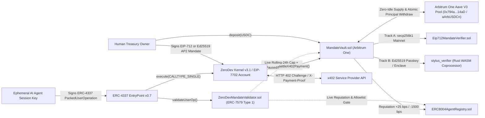

# MandateVault · Arbitrum-Native Trifecta Protocol (`Stylus Rust × ZeroDev ERC-7579/EIP-7702 × Aave V3 / x402`)

**MandateVault** is a non-custodial smart-contract treasury, ERC-7579 modular session-key validator, and autonomous payment firewall built natively for **Arbitrum One (`Chain ID 42161`)** and **Arbitrum Stylus (`Chain ID 421614`)**. It unites all three Arbitrum Open House featured partner tracks — **Arbitrum Stylus (Rust)**, **ZeroDev Account Abstraction (Kernel v3.1 / ERC-7579 / EIP-7702 Session Keys)**, and **Arbitrum DeFi (Aave V3 Native USDC + HTTP `x402` + `ERC-8004`)** — enabling AI Agents to settle HTTP `402 Payment Required` API and compute challenges in milliseconds while keeping 100% of idle treasury capital continuously earning real yield inside **Arbitrum One Aave V3 (`aArbUSDCn`)**, and deterministically reverting prompt-injection drains, `delegatecall` takeovers, 24-hour Sybil split-order bursts, and unverified service providers on-chain.

> **Live Demo Video (1080p, 2m 29s)**: https://youtu.be/0-qLbQt01qU

---

## Arbitrum Native Trifecta Architecture & What Was Built Fresh

Inspired by our earlier Web2 research into human-signed AP2 procurement mandates, **100% of the Solidity `0.8.28` smart contracts, ZeroDev Kernel v3.1 ERC-7579 Validator module, Rust Stylus cryptographic coprocessor, TypeScript/Python x402 SDKs, 10,000-run EVM fuzz suite, and Obsidian Vault Terminal in this repository were engineered from scratch specifically for Arbitrum**:



### Three Featured Partner Tracks Unified End-to-End
1. **Track 1 — Arbitrum One Aave V3 Zero-Idle Yield + `x402` + `ERC-8004`**:
   - Directly integrates Circle Native USDC (`0xaf88d065e77c8cC2239327C5EDb3A432268e5831`) and Arbitrum One's Aave V3 `aArbUSDCn` reserve (`0x794a61358D6845594F94dc1DB02A252b5b4814aD`, `$184.71M+` TVL @ `3.3361%` APR / `3.3923%` APY verified live at Block `#525,656,561`).
   - Agent settlements withdraw *only* exact principal (`principalDeposited -= amount`), ring-fencing 100% of accrued `aArbUSDCn` interest strictly for the human Vault Owner (`harvestYield()`).
   - Full cryptographic verification + ERC-8004 reputation check + true 86,400s sliding-window accounting + Aave V3 atomic redemption executes in `~155k–190k` gas (`< $0.0002` at `0.02 gwei` on Arbitrum One), making `$0.25` HTTP 402 micro-payments economically viable.
2. **Track 2 — ZeroDev Account Abstraction (`Kernel v3.1` / `ERC-7579` / `EIP-7702` Session Keys)**:
   - `contracts/ZeroDevMandateValidator.sol` (`9,053 B` runtime) implements the canonical **ERC-7579 `IERC7579Validator` (Module Type `1`)** interface (`onInstall`, `onUninstall`, `isModuleType`, `isInitialized`, `validateUserOp`, `isValidSignatureWithSender`) for **ZeroDev Kernel v3.1+** smart accounts and **EIP-7702** delegated EOAs.
   - Connects ephemeral AI Agent session keys directly to `MandateVault`'s live 86,400-second rolling spend window, sorted-pair Merkle provider allowlist, and `ERC8004AgentRegistry` reputation gate **right at the ERC-4337 `validateUserOp` boundary** — rejecting `CALLTYPE_DELEGATECALL`, smuggled `CALLTYPE_BATCH`, native ETH drain, admin selector calls (`withdrawPrincipal`, `harvestYield`, `emergencyExitAave`), malleable high-`s` ECDSA signatures, and over-cap UserOps before execution.
   - Uses O(1) `installEpoch` isolation on `onUninstall` so stale session keys can never resurrect upon module reinstall, supports multi-session rotation/revocation and defensive `raiseDispute`, and returns packed ERC-4337 `ValidationData` (`validAfter` / `validUntil`) intersected with the AP2 Mandate window.
3. **Track 3 — Arbitrum Stylus (Rust WASM) Dual-Track Cryptographic Coprocessor**:
   - Aligned with the October 2, 2026 Arbitrum Security Council governance safeguard (raising new Arbitrum One WASM activation gas limits to `2^64 - 1`), `MandateVault.sol` decouples custody from signature verification via `IMandateVerifier` (`0xf45d01ce`):
   - **Track A (Arbitrum One Mainnet Ready Today)**: `Eip712MandateVerifier.sol` (`680 B`) enforces EIP-2 non-malleable `secp256k1` EIP-712 signatures with zero WASM activation blockage.
   - **Track B (Arbitrum Sepolia / Post-Pause Zero-Migration Upgrade)**: `stylus_verifier/` implements full IETF RFC 8032 Ed25519 + FIPS-202 Keccak-256 in pure zero-dependency Rust (`wasm32-unknown-unknown` Stylus `user_entrypoint`, `16 KB` release build), cutting Ed25519 verification cost by ~95% (`~24,800` gas equivalent vs `~500,000+` pure EVM gas).

---

## Repository Structure

| Path | Description |
| :--- | :--- |
| `contracts/MandateVault.sol` | Core Zero-Idle Aave V3 + AP2 + x402 + True 86,400s Sliding Window + Optimistic Dispute Timelock Escrow vault (`14,591 B` runtime) |
| `contracts/ZeroDevMandateValidator.sol` | ERC-7579 Module Type `1` Validator connecting ZeroDev Kernel v3.1+ & EIP-7702 session keys to `MandateVault` rolling-24h caps & ERC-8004 allowlists (`9,053 B` runtime) |
| `contracts/ERC8004AgentRegistry.sol` | On-chain ERC-8004 Trustless Agents identity, capability root, reputation bps (`+25 bps` reward / `-1,500 bps` dispute slash) |
| `contracts/Eip712MandateVerifier.sol` | Mainnet `IMandateVerifier` with EIP-2 low-`s` malleability protection |
| `contracts/interfaces/IERC7579Validator.sol` | Canonical ERC-4337 v0.7 `PackedUserOperation`, `IERC7579Module`, and `IERC7579Validator` interfaces |
| `stylus_verifier/` | Pure-Rust Arbitrum Stylus Ed25519 + EIP-712 AP2 Mandate coprocessor (`src/lib.rs`, `src/ed25519.rs`, `src/keccak.rs`) |
| `sdk/typescript/index.ts` | 3-line `createMandateAgent` x402 client, Merkle allowlist builder, EIP-712 signer & live Arbitrum One RPC reader |
| `sdk/typescript/gateway.ts` | Live HTTP `402 Payment Required` provider gateway + interactive EVM Vault simulation server |
| `sdk/python/client.py` | Zero-dependency Python Agent SDK (`MandateVaultAgent`, pure-Python Keccak-256, EIP-712 parity & live Arbitrum One RPC telemetry) |
| `ui/` | Institutional Deep Obsidian (`#121210`) & Warm Crimson-Gold (`#D97706`) Treasury Terminal connected to `https://arb1.arbitrum.io/rpc` |
| `test/` | Full EVM unit suite (`vault.protocol.test.mjs`, `zerodev.validator.test.mjs`), 200 Red-Team + 22 ERC-7579 attack vectors, 10,000-run randomized EVM fuzz invariant suite, TS/Python x402 tests, and UI color/anti-secret audits |

---

## Quick Start & Verification

```bash
# 1. Compile all Solidity contracts (solc 0.8.28, viaIR + optimizer)
npm run compile

# 2. Capture live Arbitrum One RPC snapshot (https://arb1.arbitrum.io/rpc)
npm run snapshot

# 3. Run ZeroDev ERC-7579 validator + MandateVault contract suites (10/10 tests, 222 attack vectors)
npm run test:contracts

# 4. Run full verification suite (Contracts + ZeroDev ERC-7579 + 10,000 EVM Fuzz + Rust Stylus + TS/Py SDK + UI Audit)
npm run test:all

# 5. Launch live HTTP 402 Gateway & Obsidian Vault Terminal
npm run serve:gateway

# 6. Preflight or broadcast deployment to Arbitrum One / Arbitrum Sepolia
npm run deploy:arbitrum -- --dry-run
```
