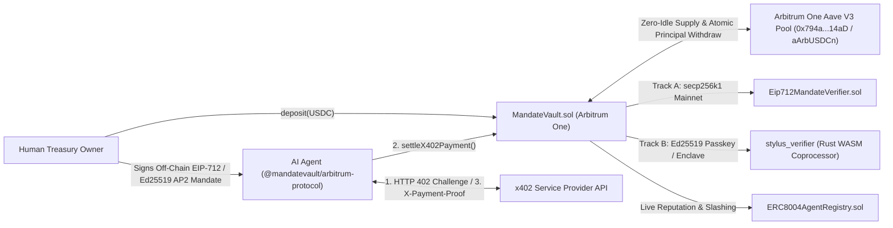

# MandateVault · Arbitrum-Native `AP2 × x402 × ERC-8004` Zero-Idle Aave V3 Settlement Vault

**MandateVault** is a non-custodial smart-contract treasury and autonomous payment firewall built natively for **Arbitrum One (`Chain ID 42161`)** and **Arbitrum Stylus (`Chain ID 421614`)**. It enables AI Agents to settle HTTP `402 Payment Required` (`x402`) API and compute challenges in milliseconds using **Circle Native USDC** while keeping 100% of idle treasury capital continuously earning real yield inside **Arbitrum One Aave V3 (`aArbUSDCn`)** — and deterministically reverting prompt-injection drains, 24-hour Sybil split-order bursts, and unverified service providers on-chain.

---

## Arbitrum Native Architecture & What Was Built Fresh

Inspired by our earlier Web2 research into human-signed AP2 procurement mandates, **100% of the smart contracts, Rust Stylus cryptographic coprocessor, TypeScript/Python x402 SDKs, EVM 10,000-run fuzz suite, and Obsidian Vault Terminal in this repository were engineered from scratch specifically for Arbitrum**:



### Why Arbitrum Is Essential
1. **Zero-Idle Native USDC + Aave V3 Liquidity**: Directly integrates Circle Native USDC (`0xaf88d065e77c8cC2239327C5EDb3A432268e5831`) and Arbitrum One's `$193M+` Aave V3 `aArbUSDCn` reserve (`0x794a61358D6845594F94dc1DB02A252b5b4814aD`). Agent settlements withdraw *only* exact principal (`principalDeposited -= amount`), ring-fencing 100% of accrued `aArbUSDCn` interest for the human Vault Owner.
2. **Sub-Cent L2 Gas & 250ms Block Finality for `x402`**: Full cryptographic verification + ERC-8004 reputation check + 86,400s sliding-window accounting + Aave V3 atomic redemption executes in `~155k–190k` gas (`< $0.0002` at `0.02 gwei` on Arbitrum One), making `$0.25` HTTP 402 micro-payments economically viable.
3. **Dual-Track Verifier Architecture (Aligned with Oct 2, 2026 Arbitrum Security Council Governance)**:
   - Following the October 2, 2026 Arbitrum Security Council action setting new WASM activation gas limits to `2^64 - 1` on Arbitrum One, `MandateVault.sol` decouples custody from signature verification via `IMandateVerifier` (`0xf45d01ce`):
   - **Track A (Arbitrum One Mainnet Ready Today)**: `Eip712MandateVerifier.sol` enforces EIP-2 non-malleable `secp256k1` EIP-712 signatures with zero WASM activation blockage.
   - **Track B (Arbitrum Sepolia / Post-Pause Zero-Migration Upgrade)**: `stylus_verifier/` implements full IETF RFC 8032 Ed25519 + FIPS-202 Keccak-256 in pure zero-dependency Rust (`wasm32-unknown-unknown` Stylus `user_entrypoint`), cutting Ed25519 verification cost by ~95% (`~24,800` gas equivalent vs `~500,000+` pure EVM gas).

---

## Repository Structure

| Path | Description |
| :--- | :--- |
| `contracts/MandateVault.sol` | Core Zero-Idle Aave V3 + AP2 + x402 + True 86,400s Sliding Window + Optimistic Dispute Timelock Escrow vault |
| `contracts/ERC8004AgentRegistry.sol` | On-chain ERC-8004 Trustless Agents identity, capability root, reputation bps (`+25 bps` reward / `-1,500 bps` dispute slash) |
| `contracts/Eip712MandateVerifier.sol` | Mainnet `IMandateVerifier` with EIP-2 low-`s` malleability protection |
| `stylus_verifier/` | Pure-Rust Arbitrum Stylus Ed25519 + EIP-712 AP2 Mandate coprocessor (`src/lib.rs`, `src/ed25519.rs`, `src/keccak.rs`) |
| `sdk/typescript/index.ts` | 3-line `createMandateAgent` x402 client, Merkle allowlist builder, EIP-712 signer & live Arbitrum One RPC reader |
| `sdk/typescript/gateway.ts` | Live HTTP `402 Payment Required` provider gateway + interactive EVM Vault simulation server |
| `sdk/python/client.py` | Zero-dependency Python Agent SDK (`MandateVaultAgent`, pure-Python Keccak-256, EIP-712 parity & live Arbitrum One RPC telemetry) |
| `ui/` | Institutional Deep Obsidian (`#121210`) & Warm Crimson-Gold (`#D97706`) Treasury Terminal connected to `https://arb1.arbitrum.io/rpc` |
| `test/` | Full EVM unit suite, 200 Red-Team adversarial attack vectors, 10,000-run randomized EVM fuzz invariant suite, TS/Python x402 tests |

---

## Quick Start & Verification

```bash
# 1. Compile all Solidity contracts (solc 0.8.28, viaIR + optimizer)
npm run compile

# 2. Capture live Arbitrum One RPC snapshot (https://arb1.arbitrum.io/rpc)
npm run snapshot

# 3. Run full verification suite (Contracts + 200 Red-Team Attacks + 10,000 EVM Fuzz Runs + Rust Stylus + TS/Py SDK + UI Audit)
npm run test:all

# 4. Launch live HTTP 402 Gateway & Obsidian Vault Terminal
npm run serve:gateway

# 5. Preflight or broadcast deployment to Arbitrum One / Arbitrum Sepolia
npm run deploy:arbitrum -- --dry-run
```

## License

Apache License 2.0 — see [LICENSE](LICENSE).

Repository: `https://github.com/Qidianyan/mandatevault-arbitrum`
